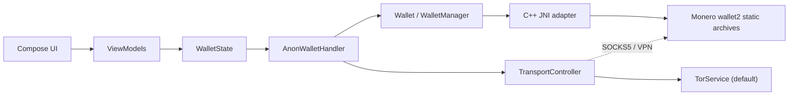

# ANONERO

Privacy- and security-focused Monero wallet for Android, with a full wallet flavor (ANON)
and a view-only flavor (NERO).

ANONERO is an Android/Kotlin application with a Jetpack Compose UI and a C++/JNI adapter
over the official Monero `wallet2` engine. The native wallet archives are built separately
from the pinned Monero sources and dependency inputs under `external-libs/`.

## Documentation

| Document | Contents |
| --- | --- |
| [`docs/architecture/overview.md`](docs/architecture/overview.md) | Modules, state flow, wallet lifecycle, persistence, transports, native boundary |
| [`docs/architecture/network-transport.md`](docs/architecture/network-transport.md) | Transport modes, proxy policy, node selection, VPN/I2P limits |
| [`docs/architecture/jni-boundary.md`](docs/architecture/jni-boundary.md) | Kotlin/C++/wallet2 contracts, handles, callbacks, errors |
| [`docs/security-model.md`](docs/security-model.md) | Assets, threat model, invariants, privacy limits, known issues |
| [`docs/features.md`](docs/features.md) | Implemented features and their limitations |
| [`docs/development.md`](docs/development.md) | Repository layout, conventions, static checks, extension recipes |
| [`docs/build-and-release.md`](docs/build-and-release.md) | Gradle, native build, CI, signing, release |
| [`docs/architecture/repository-state.md`](docs/architecture/repository-state.md) | Audited state, evidence, decisions, blockers |
| [`docs/architecture/dependencies.md`](docs/architecture/dependencies.md) | Dependency inventory and update record |
| [`PROGRESS.md`](PROGRESS.md), [`ROADMAP.md`](ROADMAP.md), [`TODO.md`](TODO.md) | Current progress, priorities, and actionable work |

Agent-specific instructions live in [`AGENTS.md`](AGENTS.md) and `.agents/skills/`.

## Requirements

- Android 10 (API 29) or later.
- Builds from this source cannot be installed or updated on Android 9 or earlier.
- Supported ABIs: `arm64-v8a` and `armeabi-v7a`. There is no `x86_64` native target.

## Download

Signed APKs are published on the project’s GitHub Releases page. The release workflow
builds ANONERO and NERO in three APK variants each (arm64-v8a, armeabi-v7a, universal),
signs them with the protected release key, and publishes `SHA256SUMS`.

Do not use APKs from an untrusted mirror. Verify the checksum and signature when distributing
or installing outside the official release page.

## Main features

- Monero only, with Polyseed and legacy seed restore.
- Explicit transport policy: embedded Tor by default, external Tor (Orbot/InviZible), external I2P (i2pd, InviZible, or the official I2P for Android app), system VPN, or a custom SOCKS5 proxy. Tor/I2P/custom fail closed; system VPN is clearnet-only and never falls back.
- Optional Monero Light Wallet Server (LWS) over the selected transport, with a matching
  destination network and TLS required for non-loopback clearnet.
- Passphrase encryption on seeds.
- No intentional subaddress reuse.
- Encrypted backups with v3 AEAD and v1/v2 restore compatibility.
- UTXO management: freeze/thaw and coin control.
- Airgapped unsigned/signed transaction and key-image/output exchange over QR/UR.
- Multiple Monero accounts and subaddresses.
- Pay to many.
- Message signing and verification.
- Stealth mode: redacted notifications, hidden amounts, optional auto-lock, no persisted logs.
- Separate decoy wallet with an optional duress PIN.
- Secure wipe of the active profile.
- English, Spanish (Spain), Russian, and Simplified Chinese UI with an in-app language selector.

## Architecture at a glance



`WalletState` is the UI-facing source of truth. `AnonWalletHandler` opens/closes the wallet,
resolves the profile, applies the proxy, configures the daemon/LWS, and wipes. One managed
wallet exists per process; the decoy and backup re-keying use explicitly unmanaged wallets.
See the architecture document for the complete flow.

## Build from source

The build has two parts:

1. **Native archives.** `external-libs/` builds official Monero `v0.18.5.4` plus the pinned
   ANONERO wallet-API patch series, and the required dependencies, in a reproducible
   container. The Monero source is a pinned submodule; changes are applied as patches, not
   as edits to the submodule.
2. **Android APK.** Gradle compiles the Kotlin app and the C++ JNI adapter, then packages
   the prebuilt archives into the `anon` or `nero` flavor.

```sh
git clone --recurse-submodules https://github.com/daviduhden/ANONERO.git
cd ANONERO

cd external-libs
sudo make android     # arm64-v8a + armeabi-v7a
sudo make linux       # optional desktop libanonero.so
sudo make             # all targets
```

If the repository was cloned without submodules, run
`git submodule update --init --recursive` before building.

`sudo` is only needed because the build drives Docker or Podman. Use `CONTAINER=podman` for a
rootless Podman setup. The first build downloads several hundred megabytes; parallelism
defaults to `nproc` and can be overridden with `make NPROC=4`.

Open the repository in Android Studio and build the `anon` or `nero` flavor. The Android
build consumes `external-libs/arm64-v8a` and `external-libs/armeabi-v7a`.

**Current checkout note:** the pinned ANONERO patch series is present under
`external-libs/patches/` and applies cleanly to the pinned commit, but the Monero submodule
is uninitialized locally; CI builds the native archives, both debug APKs, and runs the
API 35 smoke tests. See [`external-libs/patches/README.md`](external-libs/patches/README.md) and
[`docs/architecture/repository-state.md`](docs/architecture/repository-state.md).

For the full build/release pipeline, including CI jobs, signing, and artifact checks, see
[`docs/build-and-release.md`](docs/build-and-release.md).

## Security and limitations

- The recovery seed and passphrase are the ultimate recovery path. Back them up offline.
- The wallet password is a random secret wrapped by Android Keystore; the PIN gates access
  to it. A Keystore reset or device change can make the device-local wallet unreadable.
- Tor hides the network path, not transaction amounts, timing, or sync patterns. I2P and VPN have different properties; a VPN flag does not prove per-app routing or leak protection.
- LWS sees the public address and view key and is treated as untrusted. It is optional; its
  destination must match the selected transport and non-loopback clearnet requires TLS.
- The decoy wallet is separation of wallet files and secrets, **not** plausible deniability.
- Stealth mode reduces casual exposure; it is not anonymity and does not defeat root,
  accessibility services, or screen capture.
- Existing backups include v1/v2 compatibility paths. Do not write new data with the legacy
  unauthenticated format.

Read [`docs/security-model.md`](docs/security-model.md) before changing key handling,
transactions, backups, Tor/LWS, or profile isolation.

## Project layout

| Path | Purpose |
| --- | --- |
| `app/` | Android application and JNI adapter |
| `external-libs/` | Pinned Monero and native dependency build |
| `scripts/` | Static JNI and localization checks |
| `.github/workflows/` | CI, signing, and release |
| `docs/` | Technical documentation |
| `.agents/` | Agent instructions and skills |
| `AGENTS.md` | Repository-wide contributor/agent contract |

## Development

Use [`docs/development.md`](docs/development.md) for conventions, state/threading rules,
persistence rules, static checks, and recipes for adding screens, preferences, native
methods, dependencies, or migrations.

Agent work must not compile, run tests, or execute workflows locally; CI is authoritative.
No commit or push is performed without explicit supervisor authorization.

## Disclaimer

Be sure to back up your wallet recovery seed AND passphrase. ANON enforces passphrase
encryption on all seeds. The maintainers are not responsible for lost or stolen funds.

## License and attribution

ANONERO is distributed under the Apache License 2.0. See [`LICENSE`](LICENSE) and
[`NOTICE`](NOTICE). The project includes code derived from Monerujo; the original copyright
and license notices apply to those portions.
