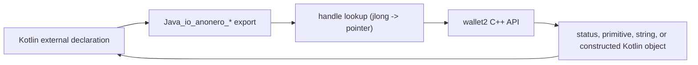

# JNI boundary

The native boundary is a C++ JNI adapter
(`app/src/main/cpp/anonero.cpp`, `anonero.h`) over the official Monero `wallet2` static
libraries. Kotlin declares the ABI as `external` methods; the adapter exports C symbols with
the `Java_io_anonero_*` naming scheme.

## 1. Call path

The adapter is compiled by `app/CMakeLists.txt`. Monero and its dependencies are prebuilt
by `external-libs/` and linked as static archives. The app does not compile wallet2.

## 2. Symbol contract

- Every Kotlin `external fun`/`external get` should have a matching export. The static
  checker is `scripts/check-jni-contract.py`.
- The checker verifies **names only**. It does not verify signatures, argument order,
  return types, or linkage. A successful check is not a successful build.
- Intentional orphans are listed in the checker:
  `Wallet_setSeedLanguage`, `Wallet_getStatusJ`, and `Wallet_isSynchronizedJ`.
- `JNI_OnLoad` caches global references to:
  `java/util/ArrayList`, `io/anonero/model/TransactionInfo`, `io/anonero/model/Transfer`,
  `io/anonero/model/WalletListener`, `io/anonero/model/Wallet$Status`, and
  `io/anonero/model/CoinsInfo`.
- If a Kotlin class is renamed or moved, update `JNI_OnLoad` and every `FindClass`/
  `GetMethodID` before expecting the app to start.

## 2.1 Proxy transport strings

`WalletManager.setProxyJ` and `Wallet.setProxyJ` receive the wallet2 proxy URI. ANONERO
sends an explicit `socks5://host:port` (bracketed IPv6) so `.onion`/`.i2p` names are
resolved by the proxy, and sends an empty string to clear the proxy in system-VPN mode.
wallet2 returns `true` when a connector is installed, not when the endpoint is reachable;
ANONERO validates numeric/loopback endpoints and treats a wallet connection failure as
fail-closed. There is no JNI getter for the native proxy value, so manager/wallet equality
remains a code-order invariant, not a runtime assertion.

## 3. Type mapping

| Kotlin / JNI | Native representation | Notes |
| --- | --- | --- |
| `String` / `jstring` | `std::string` | UTF-8; use `ScopedUtfChars` and check `get()` for null |
| `Long` / `jlong` | `int64_t` or pointer | Handles are raw pointers encoded as `jlong` |
| `Int` / `jint` | `int`/enums | Validate range before casting to unsigned or enum types |
| `Boolean` / `jboolean` | `bool` | `JNI_TRUE`/`JNI_FALSE` |
| `ByteArray` / `jbyteArray` | byte buffer | Input arrays use `JNI_ABORT`; output arrays are copied |
| `Array<String>` / `jobjectArray` | `std::vector<std::string>` | Validate lengths before pairing with amounts |
| `ArrayList<String>` / `jobject` | `std::set<std::string>` | Used for key-image selection |
| `List<...>` / `jobject` | `ArrayList` construction | `newCoinsInfo`, `newTransactionInfo`, `newTransferList` |
| Kotlin object with `handle: Long` | pointer to wallet2 object | Lifetime is owned by the wallet layer; see below |

## 4. Handle ownership

| Kotlin wrapper | Native object | Owner / release |
| --- | --- | --- |
| `Wallet` | `Monero::Wallet*` | `WalletManager`; closed through `closeJ`/`WalletManager.close` |
| `TransactionHistory` | `Monero::TransactionHistory*` | Borrowed from the wallet; valid while the wallet is open |
| `Coins` | `Monero::Coins*` | Borrowed from the wallet; valid while the wallet is open |
| `PendingTransaction` | `Monero::PendingTransaction*` | Created by wallet transaction methods; disposed by `Wallet.disposeTransaction` or when the wallet replaces it |
| `UnsignedTransaction` | `Monero::UnsignedTransaction*` | Loaded from an unsigned file; disposed through `disposeUnsignedTransaction` and released before `Wallet.close` |
| `MyWalletListener` | native listener object | Allocated by `setListenerJ`; deleting it requires deleting the global Java reference |
| `CoinsInfo`, `TransactionInfo`, `Transfer` | Kotlin objects constructed from C++ | Owned by Kotlin after construction |

`getHandle` in `anonero.h` performs no lifetime validation. It trusts that Kotlin only
passes a handle created from a live native object. Do not persist handles, send them over
IPC, or use them after `WalletManager.close`.

## 5. Callbacks and threading

- Wallet2 may invoke listener callbacks on its refresh thread.
- `MyWalletListener` serializes callback delivery with `_listenerMutex`.
- `ScopedCallbackEnv` calls `attachJVM`; it detaches the thread only when it was the one that
  attached it. Do not call `DetachCurrentThread` on an already-attached thread.
- Callbacks must be short and must not block. The Kotlin listener updates state and returns.
- The current adapter delivers `updated`, `refreshed`, `newBlock`, and
  `unconfirmedMoneyReceived`. `moneySpent`/`moneyReceived` are no-ops in this adapter.
- `setListenerJ` deletes the previous listener and its global reference before installing a
  new one, including when the wallet handle is already invalid. Replacing a listener
  without deleting the old reference leaks a Java object and its callback target.
- `Wallet.close` invalidates the Kotlin handle after wallet2 releases the object; later
  adapter calls fail closed instead of dereferencing a dangling pointer.

## 6. Error and failure mapping

The boundary has no exception channel. Each export chooses one of these contracts:

- status enum (`Wallet::Status`, `PendingTransaction::Status`,
  `UnsignedTransaction::Status`);
- `null`/`0` for an object or string that could not be produced;
- `false` for a failed boolean operation;
- an error string for operations whose Kotlin caller displays or logs the result
  (`submitTransaction`, `importOutputs`, `importKeyImages`, `signAndExportJ`);
- `wallet->errorString()` when wallet2 reports failure without throwing.

Creation, open, recovery, and wallet-init exports return `0`/false when a required Java
string cannot be converted or when wallet2 returns a null wallet. They never call
`setupBackgroundSync`/`init` on a null pointer. String/array helpers return an empty result
or skip an unreadable element instead of constructing a `std::string` from null.

C++ exceptions are caught at the export and converted to one of those failure values. A
successful-looking value must never be returned after a caught exception.

Two positional hazards are deliberate checks:

- `createTransactionMultDestJ` and `estimateTransactionFeeJ` reject empty or
  destination/amount length mismatches.
- `importKeyImages` uses an atomic re-entry guard so concurrent imports cannot interleave.

## 7. Memory rules

- Use `ScopedUtfChars` for borrowed UTF-8, `ScopedLocalRef` for local references, and
  `ScopedCallbackEnv` for callbacks.
- Check every `ScopedUtfChars::get()` result for null before constructing a `std::string`;
  the scoped wrapper releases the JNI string on every return path.
- Release every array/local reference on every return path.
- `java2cpp_bytes` treats the Java array as input; `slowHash` releases it with `JNI_ABORT`
  because the Java buffer must not be modified.
- Delete local references for constructed Kotlin objects after adding them to a list.
- Do not throw C++ exceptions across the boundary. Catch `std::exception` and `...` at the
  export.
- Validate `jint`/`jlong` before casting to `uint32_t`, `uint64_t`, or wallet2 enums.

## 8. Transaction-specific contracts

- `Wallet.createTransactionJ`, `createTransactionMultDestJ`, and
  `createSweepTransaction` return a `jlong` handle. `0` means construction failed; all
  three validate nulls, ranges, and exceptions before returning.
- `PendingTransaction.commit("", true)` commits immediately; a non-empty filename asks
  wallet2 to write an unsigned/signed file instead.
- `UnsignedTransaction.confirmationMessageJ` returns wallet2's summary built from
  `splitted_dsts`; this is the review source. The scalar address/amount/fee getters are
  advisory.
- `UnsignedTransaction.signJ` signs the **loaded** object. `Wallet.signAndExportJ` reloads
  the file from disk; use it only when signing a file that is not the reviewed object.
- `Wallet.getHistoryJ` and `getCoinsJ` return borrowed pointers. They must not outlive the
  wallet.
- `Coins.setFrozenJ`/`thawJ` use the output public key; transaction construction uses the
  key image.

## 9. Legacy and intentional exports

- `KeyStoreHelper.slowHash` is the legacy CryptoNight path used by CrAzYpass. The native
  side uses the ARM32 broken-variant policy for historical compatibility and returns a
  32-byte hash; Kotlin zeroes the result after encoding. Do not reuse it for new key
  derivation.
- `Wallet_setSeedLanguage`, `Wallet_getStatusJ`, and `Wallet_isSynchronizedJ` are intentional
  orphan exports retained for compatibility. They are allowlisted in
  `scripts/check-jni-contract.py`; adding another requires a documented reason.
- `Wallet.signAndExportJ` is a legacy file-based signing path. Prefer the reviewed-object
  `UnsignedTransaction.sign` flow for airgapped transactions.

## 10. Sensitive data

- Key material stays in wallet2. Do not add exports that return seeds, spend keys, view keys,
  or wallet passwords unless a reviewed Kotlin flow already requires them.
- Do not log passwords, PINs, Keystore material, node credentials, or proxy credentials.
  `LOGD` output reaches logcat and may be persisted by `AnonLogTree`.
- Do not interpolate `wallet->errorString()` into logs; it can contain a file path or node
  endpoint. Log the operation and use the structured status for the UI.
- Do not weaken `setTrustedDaemon(false)` for LWS on the native side.
- LWS and RPC share `Wallet_initJ`, `setProxyJ`, and `setDaemonAddressJ`; there is no
  LWS-specific native path or JNI symbol. `https://` depends on
  `0008-enforce-tls-for-https-daemon-address.patch` forcing SSL support in the Monero
  wallet API; do not reintroduce autodetect for a clearnet endpoint.
- Keep the wallet's proxy and trust state consistent with the Kotlin security policy; the
  native layer must not silently fall back to a direct connection.

## 11. Review checklist

- [ ] Kotlin `external` name and export name match.
- [ ] Constructor signature and argument order match the Kotlin model.
- [ ] All JNI strings, arrays, and local references are checked and released.
- [ ] No C++ exception crosses the boundary.
- [ ] Handle owner and release path are documented.
- [ ] Callback runs off the main thread and deletes its global reference.
- [ ] Failure values are fail-closed.
- [ ] No secret is logged.
- [ ] `scripts/check-jni-contract.py` passes; a real native build and instrumented test
      remain required for linkage and behavior.

## 12. References

- `app/src/main/cpp/anonero.h`
- `app/src/main/cpp/anonero.cpp`
- `app/CMakeLists.txt`
- `scripts/check-jni-contract.py`
- [`overview.md`](overview.md)
- [`../security-model.md`](../security-model.md)
