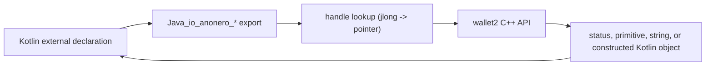

# JNI boundary

The native boundary is a C++ JNI adapter
(`app/src/main/cpp/anonero.cpp`, `anonero.h`) over the official Monero `wallet2` static
libraries. Kotlin declares the ABI as `external` methods; the adapter exports C symbols with
the `Java_io_anonero_*` naming scheme.

## 1. Call path

The adapter is compiled by `app/CMakeLists.txt`. Monero and its dependencies are prebuilt
by `external-libs/` and linked as static archives. The app does not compile wallet2.

## 2. Symbol contract

- Every Kotlin `external fun`/`external get` should have a matching export. The static
  checker is `scripts/check-jni-contract.py`.
- The checker verifies export names and four model constructor contracts. Full export
  signatures, return types, bytecode and linkage require CI.
- Intentional orphans are listed in the checker:
  `Wallet_setSeedLanguage`, `Wallet_getStatusJ`, and `Wallet_isSynchronizedJ`.
- `JNI_OnLoad` caches global references to:
  `java/util/ArrayList`, `io/anonero/model/TransactionInfo`, `io/anonero/model/Transfer`,
  `io/anonero/model/WalletListener`, `io/anonero/model/Wallet$Status`, and
  `io/anonero/model/CoinsInfo`.
- If a Kotlin class is renamed or moved, update `JNI_OnLoad` and every `FindClass`/
  `GetMethodID` before expecting the app to start.

## 2.1 Proxy transport strings

`WalletManager.setProxyJ` and `Wallet.setProxyJ` receive the wallet2 proxy URI. ANONERO
sends an explicit `socks5://host:port` (bracketed IPv6) so `.onion`/`.i2p` names are
resolved by the proxy, and sends an empty string to clear the proxy in system-VPN mode.
wallet2 returns `true` when a connector is installed, not when the endpoint is reachable;
ANONERO validates numeric/loopback endpoints and treats a wallet connection failure as
fail-closed. There is no JNI getter for the native proxy value, so manager/wallet equality
remains a code-order invariant, not a runtime assertion.

## 3. Type mapping

| Kotlin / JNI | Native representation | Notes |
| --- | --- | --- |
| `String` / `jstring` | `std::string` | JNI modified UTF-8. Use `ScopedUtfChars` and check `get()` for null |
| `Long` / `jlong` | `int64_t` or pointer | Handles are raw pointers encoded as `jlong` |
| `Int` / `jint` | `int`/enums | Validate range before casting to unsigned or enum types |
| `Boolean` / `jboolean` | `bool` | `JNI_TRUE`/`JNI_FALSE` |
| `ByteArray` / `jbyteArray` | byte buffer | Message helpers copy input. The legacy hash borrows input and releases it with `JNI_ABORT` |
| `Array<String>` / `jobjectArray` | `std::vector<std::string>` | Validate lengths before pairing with amounts |
| `ArrayList<String>` / `jobject` | `std::set<std::string>` | Used for key-image selection |
| `List<...>` / `jobject` | `ArrayList` construction | `newCoinsInfo`, `newTransactionInfo`, `newTransferList` |
| Kotlin object with `handle: Long` | pointer to wallet2 object | Lifetime is owned by the wallet layer; see below |

## 4. Handle ownership

| Kotlin wrapper | Native object | Owner / release |
| --- | --- | --- |
| `Wallet` | `Monero::Wallet*` | `WalletManager`; closed through `closeJ`/`WalletManager.close` |
| `TransactionHistory` | `Monero::TransactionHistory*` | Borrowed from the wallet; valid while the wallet is open |
| `Coins` | `Monero::Coins*` | Borrowed from the wallet; valid while the wallet is open |
| `PendingTransaction` | `Monero::PendingTransaction*` | Created by wallet transaction methods; disposed by `Wallet.disposeTransaction` or when the wallet replaces it |
| `UnsignedTransaction` | `Monero::UnsignedTransaction*` | Loaded from an unsigned file; disposed through `disposeUnsignedTransaction` and released before `Wallet.close` |
| `Wallet.listenerHandle` | `MyWalletListener*` | Installed by `setListenerJ`. Successful `closeJ` releases the Java target and deletes the adapter |
| `CoinsInfo`, `TransactionInfo`, `Transfer` | Kotlin objects constructed from C++ | Owned by Kotlin after construction |

`getHandle` in `anonero.h` performs no lifetime validation. It trusts that Kotlin only
passes a handle created from a live native object. Do not persist handles, send them over
IPC, or use them after `WalletManager.close`.

## 5. Callbacks and threading

- Wallet2 may invoke listener callbacks on its refresh thread.
- `_listenerMutex` protects the global Java target and acquisition of a local reference.
  Callbacks invoke Kotlin outside the mutex, using the target they acquired.
- `ScopedCallbackEnv` calls `attachJVM`; it detaches the thread only when it was the one that
  attached it. Do not call `DetachCurrentThread` on an already-attached thread.
- Callback work runs inline on the calling thread. The Kotlin listener can refresh
  local state, store the wallet, or restart its connection. Keep that execution context
  in mind when changing callback work or locks held during close.
- The current adapter delivers `updated`, `refreshed`, `newBlock`, and
  `unconfirmedMoneyReceived`. `moneySpent`/`moneyReceived` are no-ops in this adapter.
- The first `setListenerJ` installs an adapter before refresh starts. Later calls replace
  or clear its global Java target. A callback holding a local reference can finish against
  the previous target.
- Kotlin serializes listener mutation and native close under a dedicated monitor. After
  wallet2 confirms close, `closeJ` zeros the wallet and listener handles and releases the
  adapter. Failed close preserves both handles. History and coin handles are still
  borrowed and must be kept within the owning wallet's lifetime.

## 6. Error and failure mapping

Exports use the following return contracts:

- status enum (`Wallet::Status`, `PendingTransaction::Status`,
  `UnsignedTransaction::Status`);
- `null`/`0` for an object or string that could not be produced;
- `false` for a failed boolean operation;
- an error string for operations whose Kotlin caller displays or logs the result
  (`submitTransaction`, `importOutputs`, `importKeyImages`, `signAndExportJ`);
- `wallet->errorString()` when wallet2 reports failure without throwing.

Creation, open, recovery, and wallet-init exports return `0`/false when a required Java
string cannot be converted or when wallet2 returns a null wallet. They check the pointer
before invoking `setupBackgroundSync` or `init`. Transaction input conversion rejects the
batch on an unreadable element. History and coins refresh preserve an existing JVM
exception or raise a fixed Java failure when snapshot conversion cannot complete.

Exports must catch C++ exceptions and use the operation's failure contract. The static
symbol check covers names and model constructors. Exception containment requires a
separate review of each export.

Two positional hazards are deliberate checks:

- `createTransactionMultDestJ` and `estimateTransactionFeeJ` reject empty or
  destination/amount length mismatches.
- `importKeyImages` uses an atomic re-entry guard so concurrent imports cannot interleave.

## 7. Memory rules

- Use `ScopedUtfChars` for borrowed UTF-8, `ScopedLocalRef` for local references, and
  `ScopedCallbackEnv` for callbacks.
- Check every `ScopedUtfChars::get()` result for null before constructing a `std::string`;
  the scoped wrapper releases the JNI string on every return path.
- Release every array/local reference on every return path.
- `java2cpp_bytes` treats the Java array as input; `slowHash` releases it with `JNI_ABORT`
  because the Java buffer must not be modified.
- Delete local references for constructed Kotlin objects after adding them to a list.
- Do not throw C++ exceptions across the boundary. Catch `std::exception` and `...` at the
  export.
- Validate `jint`/`jlong` before casting to `uint32_t`, `uint64_t`, or wallet2 enums.

## 8. Transaction-specific contracts

- `Wallet.createTransactionJ`, `createTransactionMultDestJ`, and
  `createSweepTransaction` return a `jlong` handle. `0` means construction failed; all
  three validate nulls, ranges, and exceptions before returning.
- `PendingTransaction.commit("", true)` commits immediately; a non-empty filename asks
  wallet2 to write an unsigned/signed file instead.
- `UnsignedTransaction.confirmationMessageJ` returns wallet2's summary built from
  `splitted_dsts`; this is the review source. The scalar address/amount/fee getters are
  advisory.
- `UnsignedTransaction.signJ` signs the **loaded** object. `Wallet.signAndExportJ` reloads
  the file from disk; use it only when signing a file that is not the reviewed object.
- `Wallet.getHistoryJ` and `getCoinsJ` return borrowed pointers. They must not outlive the
  wallet.
- `Coins.setFrozenJ`/`thawJ` use the output public key; transaction construction uses the
  key image.

## 9. Legacy and intentional exports

- `KeyStoreHelper.slowHash` is the legacy CryptoNight path used by CrazyPass. Kotlin
  selects which historical variant to try, including the ARM32 restriction. Native code
  checks the buffer length for legacy prehashed modes and returns a 32-byte hash. Kotlin
  zeroes it after encoding. This path exists for compatibility with stored credentials.
- `Wallet_setSeedLanguage`, `Wallet_getStatusJ`, and `Wallet_isSynchronizedJ` are intentional
  orphan exports retained for compatibility. They are allowlisted in
  `scripts/check-jni-contract.py`; adding another requires a documented reason.
- `Wallet.signAndExportJ` is a legacy file-based signing path. Prefer the reviewed-object
  `UnsignedTransaction.sign` flow for airgapped transactions.

## 10. Sensitive data

- Existing seed and private-key accessors return sensitive values to Kotlin for reviewed
  flows. Treat any additional export as a change to the secret-handling boundary.
- Native adapter diagnostics are fixed warning and error literals. Android sends them to
  logcat and the desktop adapter writes them to stderr. Keep credentials and wallet
  details out of both streams.
- Do not interpolate `wallet->errorString()` into logs; it can contain a file path or node
  endpoint. Log the operation and use the structured status for the UI.
- Do not weaken `setTrustedDaemon(false)` for LWS on the native side.
- LWS and daemon RPC share transport configuration. `Wallet_initJ` passes the mode to
  wallet2, and `Wallet_lightWalletLogin` performs the LWS login. `https://` depends on
  `0008-enforce-tls-for-https-daemon-address.patch` forcing SSL support in the Monero
  wallet API; do not reintroduce autodetect for a clearnet endpoint.
- Keep the wallet's proxy and trust state consistent with the Kotlin security policy; the
  native layer must not silently fall back to a direct connection.

## 11. Review checklist

- [ ] Kotlin `external` name and export name match.
- [ ] Constructor signature and argument order match the Kotlin model.
- [ ] All JNI strings, arrays, and local references are checked and released.
- [ ] No C++ exception crosses the boundary.
- [ ] Handle owner and release path are documented.
- [ ] Listener updates and close preserve adapter lifetime, and callbacks release local references.
- [ ] Failure values are fail-closed.
- [ ] No secret is logged.
- [ ] `scripts/check-jni-contract.py` passes; a real native build and instrumented test
      remain required for linkage and behavior.

## 12. References

- `app/src/main/cpp/anonero.h`
- `app/src/main/cpp/anonero.cpp`
- `app/CMakeLists.txt`
- `scripts/check-jni-contract.py`
- [`overview.md`](overview.md)
- [`../security-model.md`](../security-model.md)

## Continued constructor/snapshot hardening (2026-11-14)

The static contract guard derives descriptors and checks reviewed parameter names/order
for CoinsInfo, Transfer, TransactionInfo and Wallet.Status. A reordered same-type argument
cannot silently pass that model check. Full JNI export signatures and bytecode still need
CI. Intermediate model/list references use scoped cleanup, and failed allocations or
record conversion no longer produce partial successful snapshots. Coins/TransactionHistory
refresh catches native exceptions and preserves/raises Java failure. closeJ catches native
failure without invalidating the wrapper until confirmed success. Kotlin owns auxiliary
wrappers through RetainedWallets and retries closure. Listener quiescence, destruction
interleavings and upstream exception-lifetime semantics remain unverified.

## Native input conversion

Message signing and verification distinguish valid zero-length input from unreadable
JNI input. A failed array read leaves the JVM exception pending and stops before
wallet2 processes the message. The transaction and fee exports perform container
allocation and input conversion inside their C++ exception guards and check the Java
types of erased key-image collection elements. These checks do not serialize raw handle
use or make callback replacement safe by themselves.
