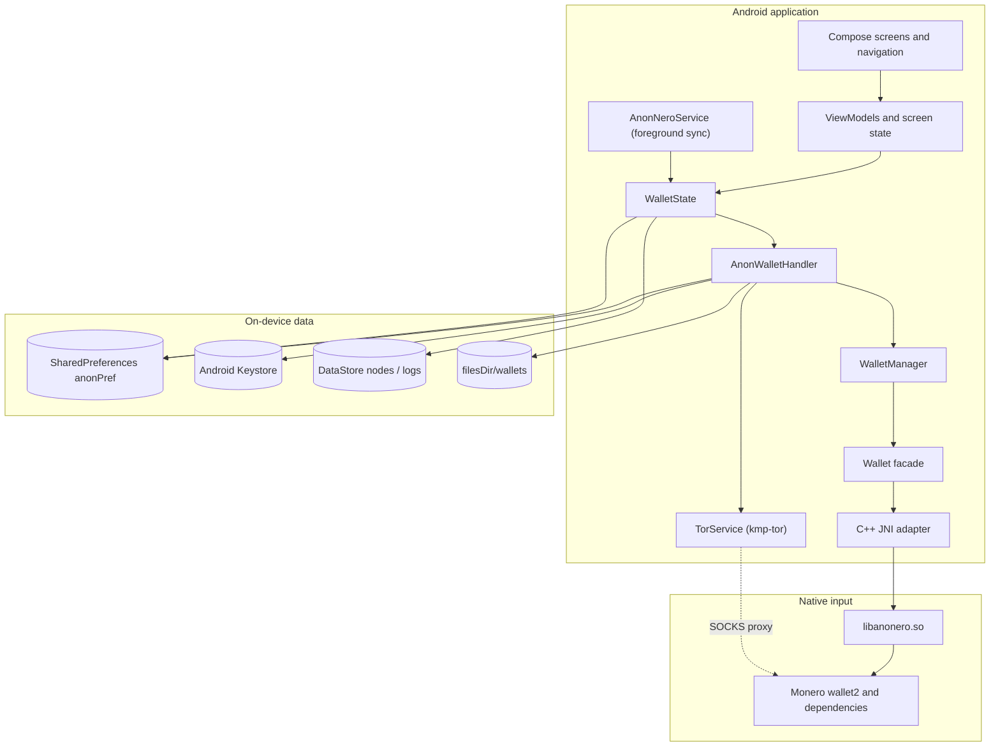
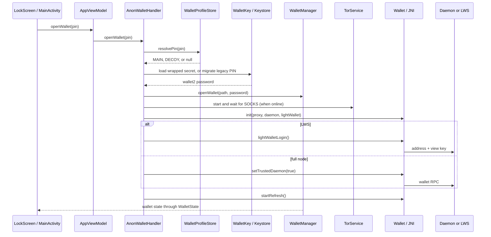
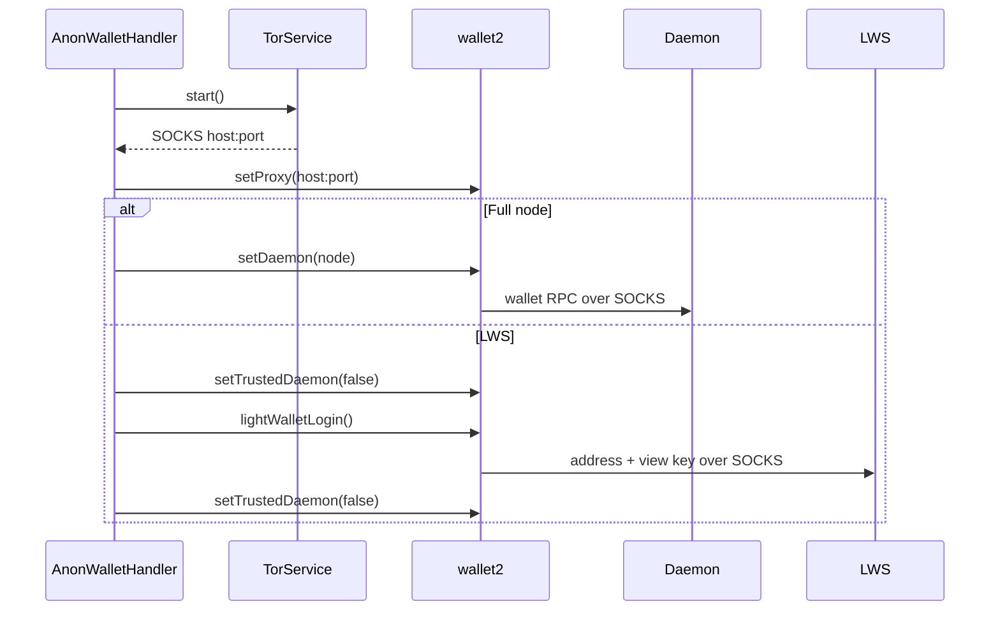

# Architecture overview

This document describes the code as it exists in the repository. It intentionally avoids
claims about runtime behavior that have not been verified by a build or device test. For the
audited state and known gaps, see [`repository-state.md`](repository-state.md).

## 1. Runtime layers

The app has one managed wallet per process. `WalletManager` owns it; `WalletState` exposes
it to the UI; `AnonWalletHandler` controls its lifecycle. `AnonNeroService` only keeps sync
alive and publishes notifications.

## 2. Module responsibilities

| Layer | Main files | Responsibility |
| --- | --- | --- |
| Process bootstrap | `AnonApplication.kt`, `AnonConfig.kt`, `di/AppModule.kt` | Context, paths, locale, Koin, logging, crash handler, startup cleanup |
| Activity and navigation | `ui/MainActivity.kt`, `ui/NavGraph.kt`, `ui/home/graph/`, `ui/onboard/graph/` | Splash, `FLAG_SECURE`, lock overlay, typed navigation graphs |
| UI | `ui/home/`, `ui/onboard/`, `ui/components/`, `ui/theme/` | Compose screens, reusable components, QR/UR UI, theme, strings |
| Screen state | `ui/viewmodels/`, `ui/home/**/ViewModel` | Screen-scoped orchestration and form state |
| Wallet state | `services/WalletState.kt` | Single UI-facing source for balances, history, accounts, sync and connection |
| Wallet lifecycle | `services/AnonWalletHandler.kt` | PIN/profile resolution, open/close, proxy, daemon, LWS, wipe |
| Sync callbacks | `services/MoneroHandlerThread.kt` | Wallet listener, refresh decisions, reconnect |
| Foreground service | `services/AnonNeroService.kt` | Persistent notification and sync keep-alive |
| Tor | `services/TorService.kt` | Embedded daemon, SOCKS endpoint, restart, logs |
| Wallet facade | `model/Wallet.kt`, `model/WalletManager.kt` | Kotlin view of wallet2 and native handles |
| Transaction models | `model/PendingTransaction.kt`, `model/UnsignedTransaction.kt`, `model/Coins.kt` | Pending/unsigned/coin-control state |
| Persistence | `util/Prefs.kt`, `store/*`, `util/backup/*` | Preferences, DataStore, wallet files, encrypted backups |
| Security utilities | `util/KeyStoreHelper.kt`, `WalletKey.kt`, `PinHash.kt`, `PinThrottle.kt`, `WalletProfiles.kt` | Keystore wrapping, PIN gate, decoy/duress profiles |
| Native adapter | `app/src/main/cpp/anonero.cpp`, `anonero.h` | JNI exports and wallet2 calls |
| Native build | `external-libs/` | Pinned Monero and dependency archives |

## 3. Process startup

`AnonApplication.onCreate` runs before Koin or UI:

1. Sets `AnonConfig.context` and applies the saved locale.
2. Starts the legacy asynchronous wallet-presence flag and initializes the wallet manager.
   The UI decides wallet presence with `WalletProfileStore.anyWalletExists`, not this flag.
3. Starts Koin with `appModule`.
4. Installs the log tree and crash handler.
5. Starts Tor when a node host or LWS is configured.
6. Deletes transient spend/export/backup files from the cache.
7. Recovers an interrupted Keystore migration before any wallet open.

`MainActivity` then installs the splash screen, sets `FLAG_SECURE`, loads theme/stealth
preferences, and hosts either the onboarding graph or the home graph. A lock overlay is
drawn above the graph while `WalletState.backgroundSyncFlow` is true.

## 4. Wallet lifecycle

The normal flow opens one wallet per process. A profile switch (for example, an unlock
using the duress PIN after a failed main unlock) closes the previous wallet first and
refuses to continue if close fails. Decoy creation and backup re-keying use explicitly
unmanaged wallets so the live wallet is not replaced.

### Lock and background sync

`MainActivity.onUserLeaveHint` enters background sync when the user leaves the app; stealth
mode optionally does the same on `onStop`. `WalletState.enterBackgroundSync` calls wallet2's
`startBackgroundSync`, which removes spend capability. The lock overlay stays visible until
`WalletState.exitBackgroundSync` succeeds with `stopBackgroundSync` and the Keystore/PIN
credential. A native failure leaves the wallet locked rather than showing an unlocked UI.

## 5. State and concurrency

- `WalletState` is the only UI-facing wallet state owner. It publishes `StateFlow` and
  `SharedFlow` values for balances, history, accounts, subaddresses, coins, sync progress,
  connection state, offline mode, background sync, and unlock shortcuts.
- `WalletManager` is a lazy process singleton. It holds one managed `Wallet`; unmanaged
  wallets are explicit exceptions for decoy provisioning and backup copies.
- `MoneroHandlerThread` runs wallet callbacks on a dedicated thread with a 5 MB stack. Its
  `refreshed` callback decides whether to resume, reconnect, or re-index. It handles LWS
  and full-node behavior differently.
- Wallet2 calls can block on disk, network, or refresh work. They are executed on IO or
  service scopes, never directly from composables.
- Security-sensitive operations (open/close, profile switch, proxy change, lock/unlock,
  wipe) are serialized or guarded. `WalletState` uses `@Synchronized` for account and
  output mutations; `AnonWalletHandler` uses the live manager/wallet identity checks to
  reject a result that belongs to a replaced session.
- `TorService` publishes its SOCKS endpoint through a replaying flow. `AnonWalletHandler`
  waits for it before applying the proxy and fails closed on timeout.

## 6. Persistence

| Data | Location | Notes |
| --- | --- | --- |
| Wallet files | `filesDir/wallets/anon`, `anon-alt` plus `.keys`/cache | MAIN and decoy are separate files and secrets |
| Wallet flags and hashes | `SharedPreferences` file `anonPref` (`AnonConfig.PREFS`) | Injected under the Koin qualifier `WALLET_PREFERENCES`; `walletPref` is the qualifier string, not a second file |
| Wrapped wallet password | `SharedPreferences` file `wallet`, key `walletSecret-<wallet>` | AES-GCM ciphertext; the AES key lives in Android Keystore |
| Legacy wrapped wallet password | Same `wallet` file, prefix `walletKey-` | RSA/Keystore compatibility path |
| Nodes | DataStore `nodes_store` | Includes RPC credentials; app-private but not Keystore-encrypted |
| Logs | DataStore `logs`, max 250 entries | Suppressed entirely in stealth mode; cleared on unlock/wipe |
| Tor | `filesDir/tor`, `cacheDir/tor` | Working and cache directories for `TorRuntime` |
| Transient exports/backups | `cacheDir` | Deleted at startup, after wipe, and around backup/restore |
| Keystore aliases | Android Keystore | `MonerujoRSA` (legacy), `walletSecret-<wallet>` (current), `walletKey-<wallet>` (legacy) |

Do not add a second preference file for wallet state. Profile-dependent keys must go
through `WalletProfileStore`, which maps MAIN/DECOY to distinct names.

## 7. Networking: Tor, daemon, and LWS

- Embedded Tor is started by `TorService`. The wallet path waits for a real SOCKS endpoint
  and throws if one does not appear within 60 seconds. There is no direct fallback.
- A manual proxy is allowed only when the user disables Tor; it must be a numeric address
  and a valid port. LWS rejects a manual proxy and requires the built-in Tor endpoint.
- A full node is marked trusted after initialization. LWS is kept untrusted before and
  after login because it is only a remote index, not a trusted daemon.
- `MoneroHandlerThread` reconnects a full node when the daemon/chain height gap is at least
  two blocks. LWS is handled separately because its scan height can legitimately trail the
  chain.
- The Tor daemon is restarted after an unexpected stop while `wanted` is true; the cached
  SOCKS endpoint is cleared before the new one is published.

Tor hides the network path. It does not hide transaction amounts, timing, sync patterns, or
the fact that a wallet is in use. LWS additionally sees the view key and incoming
transaction metadata.

## 8. UI and navigation

- `MainActivity` hosts a `NavHost` chosen by wallet presence:
  - no usable wallet: onboarding graph;
  - existing wallet: home graph, whose start destination is the lock screen unless the
    wallet is already open and healthy.
- Home navigation is a nested graph with bottom destinations Transactions, Receive, Send,
  and Settings. Settings links to accounts, subaddresses, node/proxy/LWS, seed, backup,
  logs, sign/verify, decoy settings, and secure wipe.
- Onboarding is a nested graph for create, seed restore, encrypted backup restore, node
  setup, passphrase, PIN, and view-only key import.
- Routes are serializable data classes/objects; arguments are passed through the route, not
  through global mutable navigation state.
- UI text is localized. All user-visible strings live in Android resources; the static
  `scripts/check-i18n.py` check enforces parity and catches hardcoded text.

`ui/NavGraph.kt` contains no executable code; it has only the license header and a stub
note. `HomeGraph.kt` and `OnboardingGraph.kt` are the effective graph builders.

## 9. Native boundary and build

The app compiles only its JNI adapter (`app/CMakeLists.txt`). Monero and its dependencies are
built separately by `external-libs/` into `external-libs/<abi>/` and consumed as static
archives. The ABI set is `arm64-v8a` and `armeabi-v7a`.

Kotlin-to-native calls are C++ JNI exports (`Java_io_anonero_*`). See
[`jni-boundary.md`](jni-boundary.md) for the contract, handle ownership, callback threading,
and error mapping.

## 10. Cross-cutting behavior

- **Localization:** base, Spanish (Spain), Russian, and Simplified Chinese; plural and
  placeholder parity is checked in CI.
- **Logging:** `Timber` through `AnonLogTree`; release builds persist info and above, debug
  builds also persist debug. Stealth mode suppresses persistence.
- **Clipboard:** `SecureClipboard` marks text sensitive on API 33+ and clears it after 60
  seconds if it is still the primary clip.
- **Backups:** v3 writer with passphrase-keyed wallet files; v1/v2 readers retained. The
  decoy cannot be exported through this path.
- **Failure policy:** proxy, Tor, LWS login, Keystore load, wallet init, and transaction
  review fail closed. A static review is not a proof of runtime correctness.

## 11. What is not present

- An alternate native runtime, FFI layer, or project-owned Java.
- A checked-in Monero patch series (the native build is blocked until it is restored).
- A checked-in Gradle dependency lockfile or verification metadata.
- Runtime, device, or cryptographic validation performed by this documentation pass.

## 12. Related documents

- [JNI boundary](jni-boundary.md)
- [Security model](../security-model.md)
- [Features](../features.md)
- [Development](../development.md)
- [Build and release](../build-and-release.md)
- [Repository state](repository-state.md)
- [Dependencies](dependencies.md)
