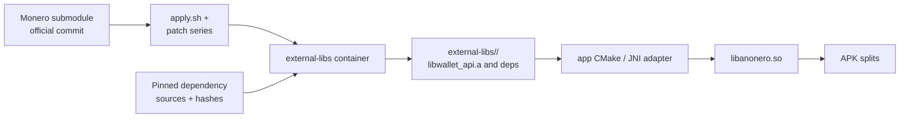

# Build and release

This document explains how the Android app and native libraries are built, how CI validates
them, and how signed APKs are published. Version pins are current as of the dependency audit
in [`architecture/dependencies.md`](architecture/dependencies.md).

## 1. Build inputs

| Input | Current pin | Source |
| --- | --- | --- |
| Gradle | 9.9.0 | `gradle/wrapper/gradle-wrapper.properties` + wrapper JAR |
| Android Gradle Plugin | 9.5.1 | `gradle/libs.versions.toml` |
| Kotlin / Compose compiler | 2.4.21 | `gradle/libs.versions.toml` |
| Java build JDK | 17 | workflows; AGP 9.5 minimum/default |
| compileSdk / targetSdk | 37.2 / 37.0 | `app/build.gradle.kts` |
| Build Tools | 37.0.0 | `app/build.gradle.kts` |
| NDK (app and native) | 30.0.16248370 / r30 | `app/build.gradle.kts`, `external-libs/build.sh` |
| CMake (app and native) | 4.1.2 / 4.4.5 | `app/build.gradle.kts`, `external-libs/build.sh` |
| Monero | v0.18.5.4, commit `85f036ba…` | gitlink/README |
| Min SDK | 29 | `app/build.gradle.kts` |

The native build also pins Boost, zlib, OpenSSL, libsodium, Expat, Unbound, libzmq, libiconv,
Polyseed, utf8proc, the Debian base image, and the Debian snapshot. See
`external-libs/build.sh`, `external-libs/Makefile`, and `external-libs/Containerfile`.

## 2. Android build shape

- Module: `:app`, namespace `io.anonero`.
- Flavors: `anon` (full) and `nero` (view-only). Application IDs are
  `io.anonero.anon` and `io.anonero.nero`.
- Build types: `debug`, `release`, `stageNet` (debuggable, stagenet suffix).
- ABI splits: `arm64-v8a`, `armeabi-v7a`, plus a universal APK. `x86_64` is absent because
  there is no native build target for it.
- Release builds are deliberately unsigned in Gradle. The protected `sign` job in
  `.github/workflows/release.yml` signs them with the release keystore.
- Release minification is currently disabled (`isMinifyEnabled = false`). Enabling it
  requires reviewing JNI/reflection/kotlinx.serialization keep rules and instrumented
  validation.
- `packaging.jniLibs.useLegacyPackaging = true` is enabled; changing it affects native
  library extraction/loading and must be validated on device.
- The JNI adapter is compiled by `app/CMakeLists.txt`; wallet2 archives are prebuilt by
  `external-libs/`.
- `FLAG_SECURE`, backup exclusions, and the non-exported foreground service are app-level
  security settings; do not change them as part of a build experiment.

## 3. Native build



Intended CI flow (see `external-libs/AGENTS.md`):

1. `make -C external-libs patches` applies the pinned patch series and initializes nested
   submodules.
2. `make -C external-libs android NPROC=4` builds arm64-v8a and armeabi-v7a in the pinned
   container.
3. The `native` job stages `external-libs/<abi>/`, `include/`, and `VERSION` as an artifact.
4. The Android jobs copy that artifact into `external-libs/` and build the APKs.

The build is designed to be reproducible: pinned base image digest, Debian snapshot,
dependency versions and hashes, CMake/NDK archives, `SOURCE_DATE_EPOCH`, `ZERO_AR_DATE`,
`TZ=UTC`, and static archives. Do not add an unpinned download or a host toolchain
dependency.

**Current state:** the seven wallet-API patches are checked in under
`external-libs/patches/` and apply cleanly to the pinned commit, but the local Monero
submodule is uninitialized locally; CI builds the native archives and assembles both debug
APKs. The API 35 smoke test passed on `42874760135` but is not stable on the KVM-less
hosted runner.

## 4. GitHub Actions: test pipeline

`.github/workflows/test.yml` is manual-dispatch only and reusable by the manual release
workflow. There are no `push`, `pull_request`, or tag triggers. Every other job depends on
an `authorize` job that requires the repository owner as both `github.actor` and
`github.triggering_actor`.

| Job | Purpose |
| --- | --- |
| `authorize` | Owner gate; every other job needs it |
| `unit` | `:app:testAnonDebugUnitTest` and `:app:testNeroDebugUnitTest` |
| `lint` | Android Lint for both flavors; uploads HTML/XML reports |
| `assemble` | Links `libanonero.so` and checks the API 29 floor without an emulator |
| `jni-contract` | `python3 scripts/check-jni-contract.py` (exact class/method names, not signatures) |
| `i18n` | `python3 scripts/check-i18n.py` (parity, placeholders, unresolved resources, hardcoded text) |
| `native-language-policy` | Rejects project-owned Java sources |
| `native` | Verifies the Monero submodule/patch series, then builds the pinned archives |
| `instrumented` | API 35 emulator tests after `native` |

The instrumented job installs Android platform 37.2, Build Tools 37.0.0, NDK
30.0.16248370, and CMake 4.1.2, assembles both flavors with ABI splits disabled for test
installation, checks the API 29 floor and `libanonero.so`, then runs connected tests.

The hosted `ubuntu-24.04` runner does not expose `/dev/kvm`; the x86_64 emulator runs with
`-accel off` and can take 10-16 minutes to boot. Run `43108046671` lost `system_server`
during install, `43122308945` caught a SIGABRT while Gradle dexed the test APKs, and
`43521054641` lost the `input`/`overlay` services immediately after a 630 s boot, before
the test script. Run `43528256395` then passed both flavors after a 919 s boot. The
instrumented job builds the app and test APKs before the emulator starts, limits connected
Gradle to two workers, and `.github/scripts/run-instrumented.sh` gates on the
`package`/`activity` services, writes crash/system/main diagnostics, and retries only
attach/zero-test failures. The XML and exit-code checks are mandatory. A self-hosted KVM
runner or a device farm is required for deterministic instrumented execution; do not
relax the test gate to make the job green.

Manual test run, from the GitHub Actions UI or CLI:

```sh
gh workflow run test.yml \
  -f ref=main \
  -f run_instrumented=true
```

`ref` is optional. Every job that invokes Gradle verifies that
`gradle/wrapper/gradle-wrapper.jar` is present before invoking Gradle.

## 5. GitHub Actions: release pipeline

`.github/workflows/release.yml` is manual-dispatch only. A release is built from an existing
`v*` tag passed as `tag`; publishing is a separate opt-in `publish` input.

| Stage | What it does |
| --- | --- |
| `authorize` | Owner gate; every other job needs it |
| `test` | Calls `test.yml` with the requested tag and instrumented-test flag |
| `build` | Verifies version/tag, enforces Kotlin/C++ policy, installs native archives, builds unsigned release APKs, verifies package ID, version, minSdk, ABI splits, non-debuggability, and six artifacts |
| `sign` | Uses the protected `release` environment to sign six APKs and write `SHA256SUMS` |
| `publish` | Runs only when `publish == true`; re-checks the tag/commit, verifies checksums, and publishes without overwriting existing assets |

Manual build without publishing:

```sh
gh workflow run release.yml \
  -f tag=v1.2.3 \
  -f publish=false \
  -f run_instrumented=true
```

Manual build and publish:

```sh
gh workflow run release.yml \
  -f tag=v1.2.3 \
  -f publish=true \
  -f run_instrumented=true
```

Release invariants:

- The `tag` input is required; its core must match `versionName`, and it must point at the
  checked-out commit.
- Six APKs: `ANONERO` and `NERO`, each arm64-v8a, armeabi-v7a, and universal.
- Application IDs must be `io.anonero.anon` / `io.anonero.nero`.
- `minSdk` must be 29; release APKs must not be debuggable.
- Only arm64-v8a and armeabi-v7a are accepted; every APK contains
  `lib/<abi>/libanonero.so`.
- Signing secrets live in the `release` environment:
  `ANONERO_KEYSTORE_BASE64`, `ANONERO_KEYSTORE_PASSWORD`, `ANONERO_KEY_ALIAS`,
  `ANONERO_KEY_PASSWORD`.
- The publish job refuses to overwrite an existing release’s assets.
- Gradle caches are disabled in the publishing workflow to avoid cache poisoning before
  signing.

The repository currently has no configured environments (`gh api
repos/daviduhden/ANONERO/environments` returned zero) and `main` is not protected. The
owner must create the `release` environment with required reviewers and the four signing
secrets, and should protect `.github/workflows/` with branch protection/CODEOWNERS. The
`authorize` job is a workflow-level guard, not a substitute for repository permissions.

## 6. Human build path

The README documents the source build:

```sh
git clone --recurse-submodules https://github.com/daviduhden/ANONERO.git
cd ANONERO/external-libs
sudo make android
```

Then build the `anon` or `nero` flavor in Android Studio. This path assumes the Monero
submodule and patch series are present. The `linux` target produces a desktop
`libanonero.so`; it is not part of Android releases.

Agent work must not execute these commands; use CI.

## 7. Reproducibility and supply chain

- Keep Gradle wrapper distribution URL and SHA-256 together.
- Keep every native dependency version next to its verified hash.
- Keep GitHub Actions pinned to full commit SHAs.
- Keep the release environment isolated and the publishing cache disabled.
- Do not commit keystores, APKs, native archives, logs, or generated caches.
- A Gradle dependency lockfile or verification metadata is not checked in; adding one
  requires a Gradle resolution step in CI, not a local build.
- A checksum failure is fatal; do not replace a hash to make a build pass.

## 8. Troubleshooting matrix

| Symptom | Likely cause | Check |
| --- | --- | --- |
| `native` job fails before compiling | Monero submodule uninitialized or a patch does not apply | `git ls-tree HEAD external-libs/monero`, `ls external-libs/patches`, `make -C external-libs patches` |
| JNI symbol mismatch | Kotlin `external` name and export diverged | `python3 scripts/check-jni-contract.py` |
| Link failure in app CMake | NDK/CMake or archive set mismatch | `app/CMakeLists.txt`, `external-libs/<abi>/monero/` |
| Release APK count wrong | ABI split or flavor output missing | Build log and `app/build/outputs/apk/` |
| minSdk verification fails | Manifest/AGP change | `app/build.gradle.kts` and `aapt2 dump badging` |
| Signing fails | Missing/invalid release environment secrets | `release` environment configuration |
| Localization check fails | Missing locale key or hardcoded text | `python3 scripts/check-i18n.py` |
| Workflow YAML invalid | Syntax/permissions/action pin error | Parse the YAML statically; do not run `act` |

## 9. What is not validated by documentation

Run `43521054641` validated the AGP/Gradle/NDK/CMake build, unit tests, lint 0/0, JNI
parity, native archives, assemble/link, and `-Werror`. Instrumented execution, signing, and
release publication remain unverified; treat those claims as pending CI.
